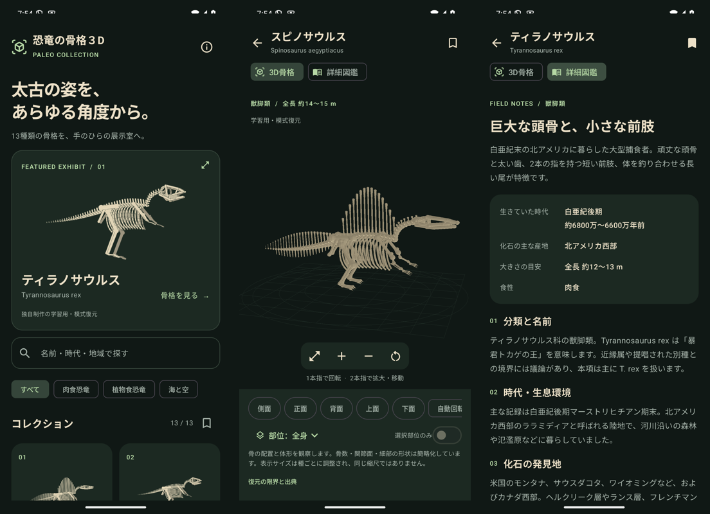

# 恐竜の骨格３D

13種類の古生物を、独自制作の3D骨格と日本語図鑑で観察するAndroidアプリです。博物館を思わせる暗い展示室で、骨格を回転・拡大縮小して見られます。

**3Dは学習用の模式復元です。実物標本のスキャン、計測用模型、学術監修済みモデルではありません。** 骨数、関節面、欠損部分、個体差は簡略化し、種類ごとの限界をアプリ内に表示しています。



## 機能

- 1本指の回転、2本指のピンチ拡大縮小・平行移動
- 側面・正面・背面・上面・下面、自動回転、全画面、リセット
- 頭骨／背骨・尾／肋骨／肩・骨盤／前肢・翼／後肢／装飾・装甲の強調と単独表示
- 13種類、計104節の日本語解説。分類、時代、生息環境、発見地、研究史、特徴、食性、推定値、未解明の点
- 名前・時代・地域による検索、分類フィルター、端末内のお気に入り
- Wikipedia記事、全13種類のYouTube関連動画検索、選定した動画・動画掲載ページ、参考資料への外部リンク
- 骨格・図鑑はオフライン。広告・解析・アカウント・通信権限なし

含む種類：スピノサウルス、ティラノサウルス、トリケラトプス、モササウルス、ヴェロキラプトル、ステゴサウルス、アンキロサウルス、ブラキオサウルス、パラサウロロフス、ギガノトサウルス、アロサウルス、プテラノドン、アーケオプテリクス。

モササウルスは海生有鱗類、プテラノドンは翼竜です。アーケオプテリクスは鳥類に近い恐竜として紹介しています。

## ビルド

JDK 17、Android SDK Platform 36、ネットワーク接続（初回のGradle依存解決）が必要です。Android 8.0（API 26）以上、OpenGL ES 2.0対応端末向け。targetSdkは36です。

```sh
# local.properties に自身のSDKを指定
printf 'sdk.dir=/path/to/Android/Sdk\n' > local.properties
./gradlew assembleDebug testDebugUnitTest lintDebug

# エミュレーターを指定。日常利用端末には入力注入しない
ANDROID_SERIAL=emulator-5554 ./gradlew connectedDebugAndroidTest

# release署名設定後
./gradlew assembleRelease bundleRelease
```

リリース署名、Play Console、プライバシーポリシー公開については [docs/RELEASE.md](docs/RELEASE.md)、説明文は [docs/PLAY_STORE.md](docs/PLAY_STORE.md)、検証記録は [docs/VERIFICATION.md](docs/VERIFICATION.md) を参照してください。

## 出典と権利

プログラム・独自骨格生成・独自アイコン：Apache License 2.0。第三者の3Dモデル、博物館写真、復元図、動画、テクスチャは同梱していません。骨格は `model/Skeleton.kt` の独自座標から生成します。

図鑑の日本語解説はWikipedia各記事の翻案で、**CC BY-SA 4.0**です。Wikipedia contributorsへの帰属、原文・編集履歴・ライセンスへのリンク、翻案であることをアプリ内と [docs/CONTENT_LICENSE.md](docs/CONTENT_LICENSE.md) に記載しています。科学的事実は博物館資料等でも確認し、その文章表現や画像は転載していません。

確認日：2026-09-07。自動更新やすべての既知情報の網羅を保証しません。大きさ・年代は推定で、研究・標本・分類により変わります。ギガノトサウルスの産地年代の再検討、スピノサウルスの2026年新種報告などは注記付きで扱います。

本アプリは各博物館、Wikimedia Foundation、YouTube、Googleの公式・提携アプリではありません。第三者の素材を追加するときは、別途ライセンス・帰属・商用再配布条件を確認してください。

## 構成

- `app/src/main/java/.../model/` — 独自メッシュ、OpenGL ES描画、カメラ、ジェスチャー
- `app/src/main/java/.../ui/` — Composeの一覧・展示室・図鑑・権利表示
- `tools/build_catalog.py` — 編集可能な図鑑の元データとJSON生成
- `app/src/main/assets/` — オフライン図鑑、プライバシー、ライセンス
- `docs/privacy/index.html` — 公開用プライバシーページ
- `app/src/androidTest/` — 13種類の描画と実操作、状態保持を検証するエミュレーターE2E

図鑑を編集したら `python3 tools/build_catalog.py` を実行し、出典と確認日、アプリ内の説明も同時に更新してください。
