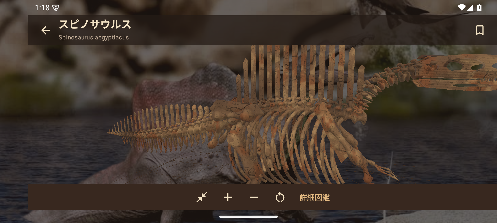
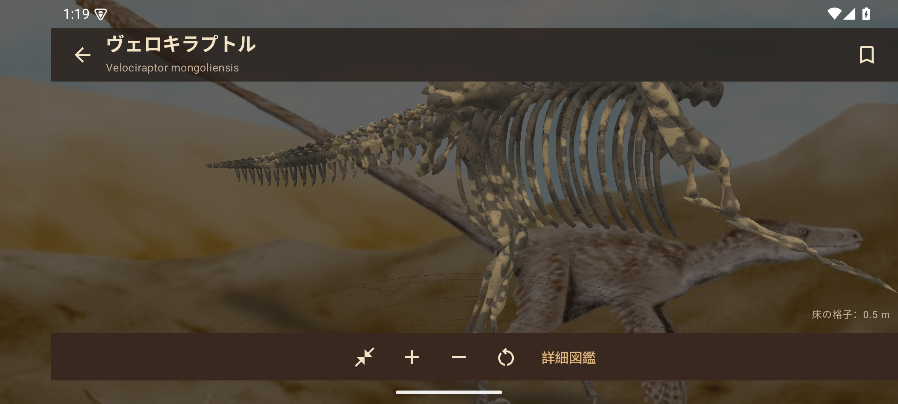
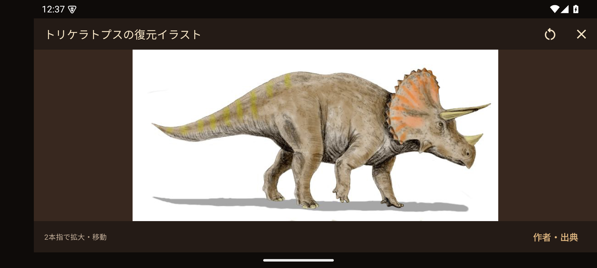
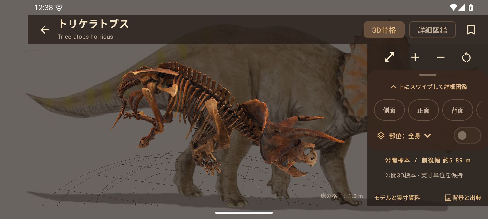
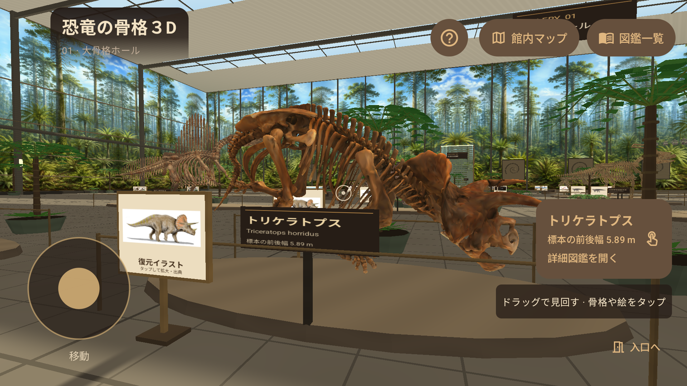
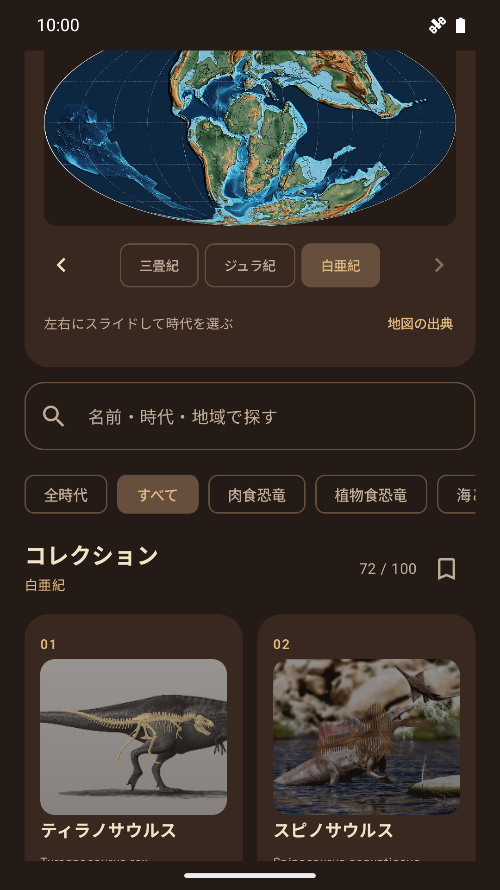
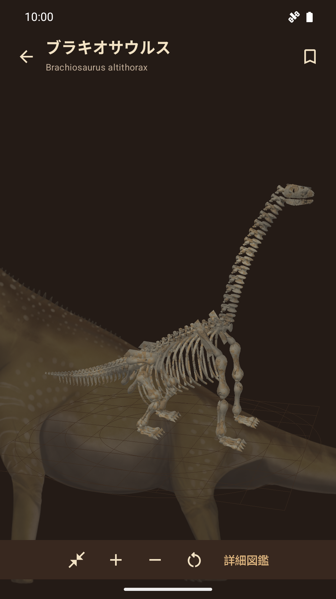
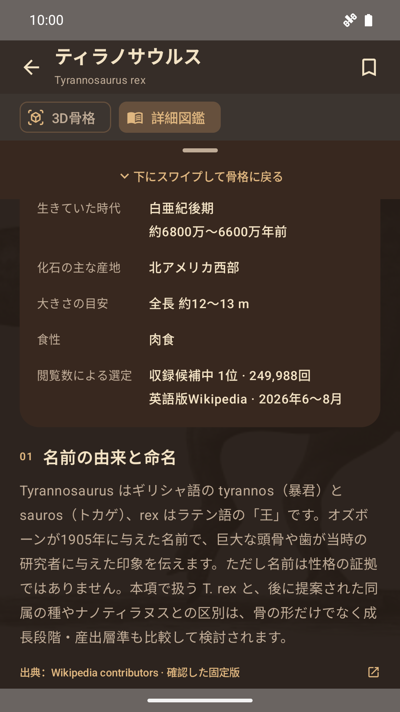

# 恐竜の骨格３D

**1.10.2：歩行速度を25%向上。** スティックの最大速度を8 m/秒から10 m/秒へ変更しました。浅く倒したときの微調整と、壁・展示台・植栽への衝突判定も維持しています。[配布ファイルと検証記録](docs/verification/1.10.2/README.md)。


Google Play公開用の資料を [公開準備の入口](docs/PLAY_STORE.md) にまとめました。**サポート：acesmash@gmail.com／対象：子どもを含む全年齢**。IARC・Play Console提出・審査は未実施です。

[プライバシーポリシー](https://hatake716.github.io/kyouryu-3d/privacy/) · [保護者向けガイド](https://hatake716.github.io/kyouryu-3d/parents/) · [素材の出典](https://hatake716.github.io/kyouryu-3d/credits/) · [提出・検証手順](docs/RELEASE.md)


100種類の骨格を展示する仮想博物館を、一人称視点で自由に歩けるAndroidアプリです。骨格をタップして詳しい日本語図鑑へ入り、個別の観察画面で回転・拡大縮小して見られます。

1.10.1では、シアターの横画面左上のタイトルパネルを、縦画面と同じ土色から透明へ抜ける背景と明るい文字色へ変更しました。背景の展示室が透けて見える表示です。 横画面では通知バーとナビゲーションバーを隠して全画面表示にします。画面端からのスワイプで一時表示でき、縦画面に戻すと通常表示へ戻ります。シアターは画面の端まで描画し、上部の文字・ボタンはカメラ穴を避けて配置します。館内マップ・案内・図鑑・復元イラストも横画面のシステムバー非表示に対応します。

**1.10.0では、独自復元96種類とパタゴティタンの計97モデルに、種類ごとの化石の表面表現を追加しました。** 赤褐色・暗褐色・砂色・灰黒色などの骨肌に、鉱物の染み、細いひび、粒子状の凹凸、部分的な付着土を重ね、艶を抑えています。個別3D観察とシアターで同じ種類の表面を使用し、図鑑一覧の骨格にも色調を反映します。 色合いと付着土は本アプリ独自の観察用表現で、実際の標本・産地の色を測定したものではありません。トリケラトプス、ティラノサウルス、カルノタウルスは元の公開資料の表面表現を使用します。 個別3D画面を閉じる際に描画用のバッファ・表面画像・シェーダーを明示的に解放し、全画面切り替えや画面回転を繰り返す際のメモリ増加も抑えています。 [表面表現の仕様](docs/FOSSIL_SURFACES.md)。

| スピノサウルスの化石表面（拡大） | ヴェロキラプトルの化石表面（拡大） |
|---|---|
|  |  |

**1.9.0では、100種類すべての展示に復元イラストの立て札を追加しました。** 名前の札の左隣にあり、タップして画像全体を閲覧、2本指で拡大・移動できます。作者と配布条件は「作者・出典」から確認できます。横画面の個別3D観察は操作欄を右側へ移し、骨格に重ならない構成へ変更。モデルの形と縦横比に合わせて初期カメラを近づけ、全身を大きく表示します。

| 復元イラストの閲覧 | 横画面の3D観察 |
|---|---|
|  |  |

**1.8.0では、中生代の巨大森林を思わせる壁画を展示室の壁面に追加しました。** 本アプリ用に生成した創作画を外周と各室の仕切り壁へ配置。横画面は上部全体の暗いグラデーションをやめ、明るいタイトルカードと操作ボタンへ整理しました。天井も明るい土色にし、天窓と森林を見渡しやすくしています。[壁画の生成記録と利用条件](docs/forest-mural-provenance.json)。

**1.7.0では、起動画面の見出しを「恐竜の骨格３D」に変更し、館内を共通のm単位へ改修しました。** 19モデルは実寸資料の単位を保持、76モデルは推定全長・翼開長へ換算し、小型種と大型種の大きさの差を表現します。5種類は寸法未確定の参考展示です。高さ32 mの展示室へ拡張し、天窓からの採光、シダ・木生シダの植栽、壁面の化石レリーフ、ベンチを追加。移動速度を最大8 m/秒へ上げました。[操作・寸法の根拠・館内モデルの条件](docs/THEATER.md)。

シアターモードは起動画面として継続し、全100種類を展示する5つの部屋を散策できます。館内マップから展示前へ移動でき、「図鑑一覧」から従来の時代別メニューも利用できます。ロイヤル・ティレル古生物学博物館の大骨格展示を参考にした独自空間で、実在館の正確な建築再現・公式アプリではありません。



**1.5.0ではティラノサウルス、カルノタウルス、パタゴティタンを詳細な公開3Dモデルへ更新しました。** トリケラトプスの公開標本を含む4種類を同梱し、残る96種類も頭骨・歯列・関節・椎骨・骨板と陰影を改良しました。4種類のうち実寸単位を確認できた公開標本はトリケラトプスで、他の3種類の実寸は未確認です。96種類中18種類には論文の骨長を反映し、78種類は実測によらない模式復元です。全100種類の実物スキャンや同じ解剖学的精度を保証するものではありません。[使用標本・測定値・反映範囲](docs/MODEL_ACCURACY.md)をアプリの「モデルと実寸資料」からも確認できます。

| 時代別コレクション | 縦画面の3D観察 | 名前の由来を読む |
|---|---|---|
|  |  |  |

[ストア用の縦4枚・横4枚と代替テキスト](docs/store/README.md)。すべて署名済み1.10.1を実行した画面です。[画像内の第三者素材の帰属と利用条件](docs/store/CREDITS.md)。

## 機能

- 初期画面は一人称の仮想博物館。全100種類を5つの展示室に配置。壁・展示台を避けて自由に散策
- 共通のm単位の館内で骨格のサイズ差を表現。寸法の根拠・推定値・未確定を表示。小型標本は拡大せず観察台へ
- 天窓の採光、260か所の植栽、化石レリーフ、ベンチ、身長1.7 mの比較用シルエット
- 左スティック移動（最大10 m/秒）とドラッグの視点操作に同時対応。骨格をタップして詳細図鑑へ。戻ると館内の位置・向きを保持
- 館内マップの100展示検索・展示室選択・展示前への移動、入口へ戻る操作、従来メニューへのショートカット
- 土色の配色。三畳紀・ジュラ紀・白亜紀の世界地図を横にスワイプし、その時代のコレクションへ切り替え。「全時代」で100項目を横断
- コレクションの各骨格カードにも、その種類の復元イメージを表示
- 各展示の名前の札の隣に復元イラストの立て札。表裏から閲覧・タップでき、画像の拡大・移動・リセットと作者・出典・ライセンスの確認に対応
- 横画面の3D観察では操作欄を右側に配置。骨格の実際の表示範囲へカメラを合わせて全身を大きく表示
- 100点の背景画。全画面への拡大／画像全体の表示、濃さ調整、作者・出典・ライセンスの確認
- 1本指の回転（1.2.0で左右を反転し、指の横移動に沿う操作へ修正）、2本指のピンチ拡大縮小・平行移動
- 個別観察の部位カード（縦画面は下部、横画面は右側）を上にスワイプして詳細図鑑へ。図鑑上部のハンドル、または本文先頭から下にスワイプすると骨格へ戻り、視点と選択部位を保持。本文の途中では通常どおりスクロール
- 側面・正面・背面・上面・下面、自動回転、全画面、リセット
- 頭骨／背骨・尾／肋骨／肩・骨盤／前肢・翼／後肢／装飾・装甲の強調と単独表示
- 100種類、注記を含む計1,327節の日本語解説。分類、時代、生息環境、発見地、研究史、特徴、食性、推定値、未解明の点
- 名前・時代・地域による検索、分類フィルター、端末内のお気に入り
- Wikipedia記事、全100種類のYouTube関連動画検索、選定した動画・動画掲載ページ、参考資料への外部リンク
- 骨格・背景画像・図鑑はオフライン。広告・解析・アカウント・通信権限なし

元の13種類：スピノサウルス、ティラノサウルス、トリケラトプス、モササウルス、ヴェロキラプトル、ステゴサウルス、アンキロサウルス、ブラキオサウルス、パラサウロロフス、ギガノトサウルス、アロサウルス、プテラノドン、アーケオプテリクス。

さらにケツァルコアトルス、ディロフォサウルス、テリジノサウルス、イグアノドンなどを含む100項目です。[全収録項目と選定根拠](docs/POPULARITY.md)をご覧ください。英語版Wikipediaの2026年6〜8月の人による閲覧数を目安に、候補中の上位100項目を選びました。世界共通の人気投票ではありません。

モササウルスは海生有鱗類、プテラノドンは翼竜です。アーケオプテリクスは鳥類に近い恐竜として紹介しています。

## ビルド

JDK 17、Android SDK Platform 36、ネットワーク接続（初回のGradle依存解決）が必要です。Android 8.0（API 26）以上、OpenGL ES 2.0対応端末向け。targetSdkは36です。

```sh
# local.properties に自身のSDKを指定
printf 'sdk.dir=/path/to/Android/Sdk\n' > local.properties
./gradlew assembleDebug testDebugUnitTest lintDebug

# エミュレーターを指定。日常利用端末には入力注入しない
ANDROID_SERIAL=emulator-5554 ./gradlew connectedDebugAndroidTest

# release署名設定後
./gradlew assembleRelease bundleRelease
```

リリース署名、Play Console、プライバシーポリシー公開については [docs/RELEASE.md](docs/RELEASE.md)、説明文は [docs/PLAY_STORE.md](docs/PLAY_STORE.md)、検証記録は [docs/VERIFICATION.md](docs/VERIFICATION.md) を参照してください。

## 出典と権利

プログラム・独自骨格生成・独自アイコン：Apache License 2.0。トリケラトプスの公開3D標本と表面画像はSmithsonian Open Access（CC0）。ティラノサウルスはRigsters（CC BY 4.0）、カルノタウルスはMagorius（CC BY 4.0）、パタゴティタンはMebaLab / lautaro.cb（CC BY-SA 4.0）の公開データです。パタゴティタンの変換後メッシュもCC BY-SA 4.0で提供します。18種類の表示に用いた測定資料はPersons・Currie（2016）およびMaidmentほか（2015）のCC BY 4.0資料で、帰属と変更を記載しています。[モデルの出典・変換・精度](docs/MODEL_ACCURACY.md)。動画は同梱していません。

全100種類に名前の由来・生態・特徴・発見史・未解明な点の500節、30種類に34節の研究ノートを追加しました。[研究確認の範囲と出典](docs/RESEARCH.md)を参照してください。

図鑑の日本語解説はWikipedia各記事の抄録・翻案と独自の増補を含み、**CC BY-SA 4.0**です。Wikipedia contributorsへの帰属、原文・編集履歴・ライセンスへのリンク、翻案であることをアプリ内と [docs/CONTENT_LICENSE.md](docs/CONTENT_LICENSE.md) に記載しています。基本情報は英語版などから整理し、追加分は日本語版の本文を抄録しています。固定版と更新の注記を併記します。

背景98点はWikimedia CommonsのCC BY／CC BY-SA等の条件に従って同梱し、2点は本アプリ用のAI生成画像です。プログラムのApache 2.0を第三者画像に適用しません。個別の帰属・ライセンス・ファイルハッシュは [artwork-provenance.json](docs/artwork-provenance.json)、生成プロンプトは [GENERATED_ARTWORK.md](docs/GENERATED_ARTWORK.md)。表示時にトリミング・明度調整を行います。

時代の地図3点はScoteseほかのPALEOMAP資料（CC BY 4.0）です。表示時に楕円投影の外側をマスクし、白亜紀画像の白い余白も土色の背景になじませます。地図は各時代の代表時点を示し、コレクションはその時代全体を対象にします。地図上の黒線は現在の国境です。[地図の出典・分類方法](docs/PALEOMAPS.md)に作者、原本、年代区分と5／25／72項目の内訳を記載しています。

確認日：2026-09-07。自動更新やすべての既知情報の網羅を保証しません。大きさ・年代は推定で、研究・標本・分類により変わります。ギガノトサウルスの産地年代の再検討、スピノサウルスの2026年新種報告などは注記付きで扱います。

本アプリは各博物館、Wikimedia Foundation、YouTube、Googleの公式・提携アプリではありません。第三者の素材を追加するときは、別途ライセンス・帰属・商用再配布条件を確認してください。

## 構成

- `app/src/main/java/.../theater/` — 仮想博物館・一人称移動・展示選択・館内メッシュ
- `tools/theater/` — 展示用軽量メッシュの再生成と権利記録
- `app/src/main/java/.../model/` — 標本の読み込み・実測値・生成メッシュ、OpenGL ES描画、カメラ、ジェスチャー
- `app/src/main/java/.../ui/` — Composeの一覧・展示室・図鑑・権利表示
- `tools/build_catalog.py` — 元の13項目と凍結した追加データからJSONを生成
- `tools/catalog/` — 候補・閲覧数の収集、本文抽出、図鑑の追加入力、模型の設定
- `tools/check_catalog.py` — 100背景画像・3地図のハッシュ・帰属と閲覧数／収録項目の整合確認
- `app/src/main/assets/` — オフライン図鑑、プライバシー、ライセンス
- `docs/privacy/index.html` — 公開用プライバシーページ
- `app/src/androidTest/` — 100種類の描画と実操作、状態保持を検証するエミュレーターE2E

図鑑を編集したら `python3 tools/build_catalog.py` を実行し、出典と確認日、アプリ内の説明も同時に更新してください。

モデル設定を編集した場合は `python3 tools/catalog/write_profiles.py` も実行します。通常のビルドはネットワークなしで図鑑・画像を利用します。Wikipedia/Commonsの再取得は `tools/catalog/` の研究用スクリプト（Python 3とlxml）で行いますが、追加前に本文、分類、画像の内容、個別の権利表示を確認してください。取得時の作業キャッシュはGit対象外です。
